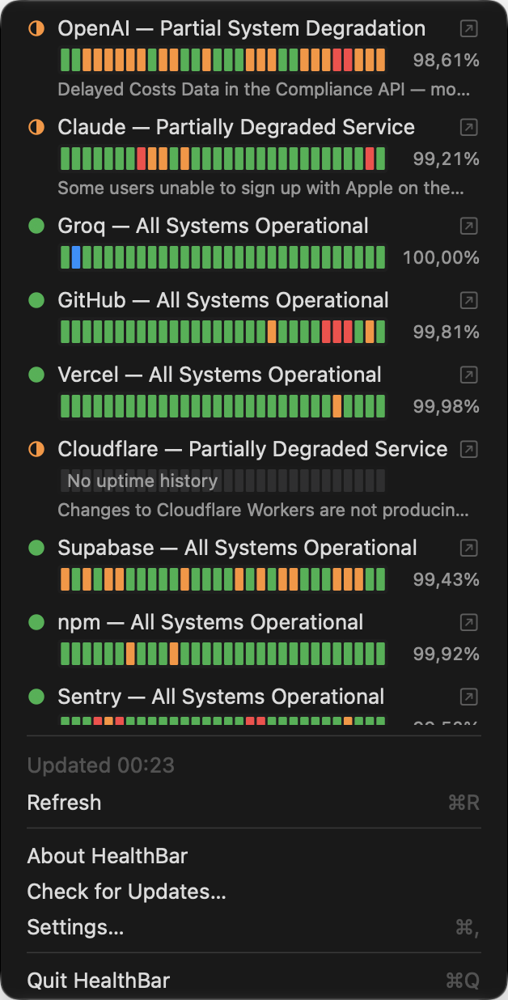
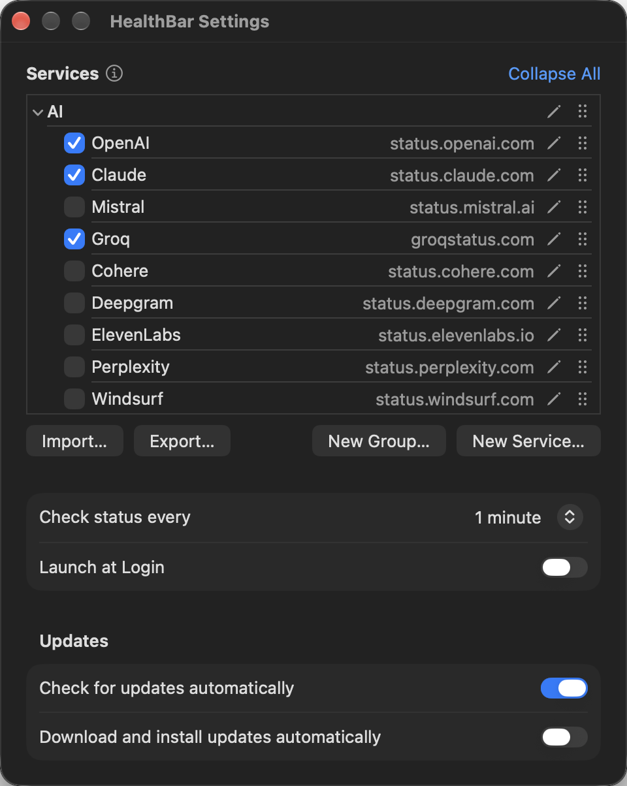

# HealthBar

macOS menu bar app showing the status of the services you depend on (GitHub, OpenAI, Claude, Vercel, Supabase by default).



## Install

```bash
brew install --cask vladforfutdinov/healthbar/healthbar
```

## Features

- **One ring for everything.** One sector per checked service (at most 10), problems first, worst first; green fills the rest.

  

- **A row per service**: its status, the current incident, and a 30-day uptime strip; a click opens the status page.
- **About 120 built-in status pages** in groups, plus any Atlassian Statuspage or incident.io page, or your own that serves the same JSON ([docs/STATUS_API.md](docs/STATUS_API.md)).
- **Keyboard and VoiceOver** reach every service in the menu; Settings works from the keyboard too.
- **Automatic updates.**



Colours, menu, Settings and where the data comes from: [docs/USAGE.md](docs/USAGE.md). The built-in pages: [docs/SERVICES.md](docs/SERVICES.md).

## Develop

```bash
swift test
scripts/build.sh && open "dist/HealthBar (dev).app"
```

Releasing: `docs/RELEASING.md`.

## License

MIT, see `LICENSE`.
