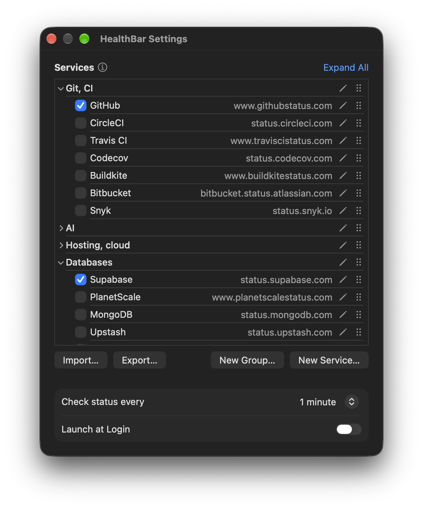

# HealthBar

macOS menu bar app showing the status of the services you depend on (GitHub, OpenAI, Claude, Vercel, Supabase by default).


## Install

```bash
brew install --cask vladforfutdinov/healthbar/healthbar
```

## Icon

The menu bar icon is a ring (donut) with one sector per checked service, at most 10. Sectors don't follow the list: clockwise from 12 o'clock, each problem status takes a share proportional to how many services have it (at least one sector), worst first, and green fills the rest. A sector's colour:

| Colour | Status |
|---|---|
| green | `none` |
| orange | `minor` |
| red | `major` / `critical` |
| blue | maintenance |
| grey | not fetched (unreachable or still loading) |

With *Differentiate without color* on (System Settings → Accessibility → Display), the icon shows `!` in its centre when a service is down and `~` when one is degraded, and maintenance glyphs in the menu get a centre dot.

In the menu each service carries its own glyph (`design/status-icons.svg`).

## Settings



Menu → Settings… (⌘,); Escape closes it. The window can be made taller; it remembers its position and which groups are folded. Menu → About HealthBar shows the version.

- **Services**: a built-in list of about 60 developer-service status pages in groups (Git, CI; AI; Hosting, cloud; Databases; Packages; Monitoring; Auth, secrets, network; Email, messaging, media; Work tools); GitHub, OpenAI, Claude, Vercel and Supabase are checked by default. Check the ones to show. Services can also sit outside any group, at the top.
  - New Service… / the pencil after a service's address: address, name (empty takes the page's own) and group. The address is checked when the field loses focus (a green check means its `status.json` answers) and again on save. Delete… is in the same sheet, with a confirmation.
  - New Group… / the pencil on a group: its name, and Delete…, which offers Delete Group Only (its services move out of the group) or Delete Group and Services.
  - Drag rows to reorder within a group, and groups among themselves. The context menu has Move Up, Move Down, Move to Group, Edit… and Delete…. Expand All / Collapse All folds the groups. The menu follows the order of the checked services.
  - Keyboard: Tab into the list, arrows to move, Space to check a service or fold a group, Return to edit, Delete to delete, ⌥⌘↑/↓ to move.
  - Deleted built-in pages stay deleted. The full list, with which pages publish uptime history: [docs/SERVICES.md](docs/SERVICES.md).
  - Import… / Export… save the whole configuration (services, groups, interval) as JSON and load it back; Import also reads a 0.2.x `services.json`.
- **Check status every**: 30 seconds to 15 minutes.
- **Launch at Login**.
- **Updates**: automatic checks and installs. Check for Updates… is in the menu.

Any Atlassian Statuspage or incident.io status page works; the platform is detected automatically. A page of your own works too if it serves the same JSON: [docs/STATUS_API.md](docs/STATUS_API.md). Changes apply at once. Settings live in the app's user defaults; a `~/Library/Application Support/HealthBar/services.json` from 0.2.x is imported once on first launch (its services checked, the rest of the list unchecked) and then ignored. Pages added to the built-in list in later versions appear unchecked.

## Menu

Eight and a half services show at once; the rest scroll. Each service row shows its status and opens the status page. A service with an active incident or a fetch error gets a third line with the first incident (and how many more) or the error; the full list is in its tooltip. Under it a 30-day strip (one bar per day, worst component that day) and the uptime of its least available component. Hovering a bar lists that day's affected components with status and duration.

Keyboard: the arrow keys move through the services (the row lights up and scrolls into view) and the items below; Return opens the service's page or runs the item. VoiceOver reads the icon's summary on the list, each service with its status, uptime or incident, and the items by name; VO-Space acts like Return.

## Data sources

| What | Statuspage | incident.io | When |
|---|---|---|---|
| Status | `<url>/api/v2/status.json` | same | every *Check status every* (1 minute by default) |
| Incidents | `<url>/api/v2/summary.json` | same | with the strip |
| Strip | `<url>/uptime_showcase?components=<ids>` (ids and names from the summary) | `<url>/proxy/<host>/component_impacts`, names from `<url>/proxy/<host>` | at launch, then hourly, and at once when the status changes |

The strip endpoints are the pages' own undocumented feeds; if one fails the strip is left out. The platform is detected by `component_impacts` answering 404 on Statuspage hosts.

## Develop

```bash
swift test
scripts/build.sh && open "dist/HealthBar (dev).app"
```

Releasing: `docs/RELEASING.md`.

## License

MIT, see `LICENSE`.
